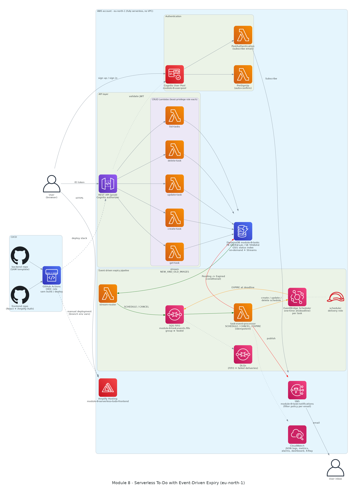

# Module 8: Serverless To-Do with Event-Driven Expiry

This is a serverless task manager. Authenticated users create tasks with a deadline. By default, the deadline is 5 minutes after the task is created. If a task is still **Pending** when its deadline passes, the system marks it **Expired** and emails the owner. Completing or deleting a task before its deadline cancels the scheduled expiry. Expiry and cancellation both run through **DynamoDB Streams, SQS FIFO and Lambda**.

The AWS SAM template (`template.yaml`) defines the whole backend and the Amplify Hosting app.

| Item | Link |
|---|---|
| Backend (SAM) repo | https://github.com/Michelle-anyika/Module-8-serverless-todo-backend |
| Frontend repo | https://github.com/Michelle-anyika/Module-8-serverless-todo-frontend |
| Region / stack | `eu-north-1` / `module-8-serverless-todo` |



The diagram is generated as code from [`docs/architecture.py`](docs/architecture.py) using the Python `diagrams` library. The render command is in that file.

## Architecture

| Concern | Service | Resource name |
|---|---|---|
| Sign-up / sign-in (email + password) | Cognito User Pool | `module-8-user-pool`, client `module-8-web-client` |
| Auto-confirm on sign-up | Lambda (PreSignUp trigger) | `module-8-pre-signup` |
| Subscribe the user to notifications | Lambda (PostAuthentication trigger) → SNS | `module-8-post-authentication` |
| REST API | API Gateway REST with a Cognito authorizer | `module-8-tasks-api` (stage `prod`) |
| CRUD | 5 Lambdas, each with its own least-privilege role | `module-8-{list,get,create,update,delete}-task` |
| Data | DynamoDB on-demand, single table, Streams | `module-8-tasks` |
| Change capture | DynamoDB Stream → Lambda | `module-8-stream-router` |
| Ordered, reliable lifecycle events | SQS FIFO + FIFO DLQ | `module-8-task-events.fifo` |
| Expiry timer | EventBridge Scheduler: one schedule per task | group `module-8-task-expiry` |
| Expiry / cancellation worker | Lambda | `module-8-task-event-processor` |
| Email | SNS, one topic with a filter policy per subscriber | `module-8-task-notifications` |
| Frontend hosting | Amplify Hosting | `module-8-serverless-todo-frontend` |
| Observability | CloudWatch Logs (JSON, 14 days), metric filters, alarms, dashboard, X-Ray | `module-8-serverless-todo` dashboard |

### DynamoDB single-table design

| Key | Value | Purpose |
|---|---|---|
| `PK` | `USER#<cognito sub>` | Partitions data per user, so a user can only ever read their own tasks |
| `SK` | `TASK#<uuid>` | Leaves room for other entity types later |
| `GSI1PK` / `GSI1SK` | `USER#<sub>` / `STATUS#<Status>#<Deadline>` | `GET /tasks?status=Pending` returns tasks sorted by deadline |

Each item has these attributes: `TaskId`, `UserId`, `UserEmail`, `Description`, `Date`, `Status` (`Pending`/`Completed`/`Expired`), `Deadline` (ISO-8601), `DeadlineEpoch`, `CreatedAt`, `UpdatedAt`, `Version` (optimistic locking), and `ExpiredAt`/`NotifiedAt` once the task expires.

### Expiry workflow

```
POST /tasks ─► DynamoDB (Pending, Deadline=now+5m)
                 │ stream INSERT
                 ▼
          stream-router ──SCHEDULE──► SQS FIFO (group=TaskId) ──► task-event-processor
                                                                     │ scheduler:CreateSchedule at(Deadline)
                                                                     ▼
                                     EventBridge Scheduler ──EXPIRE (at deadline)──► SQS FIFO ──► task-event-processor
                                                                                                  │ UpdateItem Pending→Expired (conditional)
                                                                                                  │ SNS Publish (MessageAttribute email)
                                                                                                  ▼
                                                                                          email to the task owner
```

### Cancellation workflow

```
PUT status=Completed  or  DELETE ─► DynamoDB stream MODIFY/REMOVE (old Status = Pending)
      ─► stream-router ──CANCEL──► SQS FIFO ──► task-event-processor ──► scheduler:DeleteSchedule
```

### Idempotency and decoupling

* **API and expiry logic are decoupled.** The API only writes to DynamoDB. Everything else is driven by the stream.
* **No duplicate lifecycle events.** The stream `eventID` is used as the SQS FIFO `MessageDeduplicationId`, so retried stream batches produce no duplicates.
* **Events for a task stay in order.** `MessageGroupId = TaskId` guarantees per-task ordering, so a SCHEDULE is never processed after the CANCEL that followed it. On a failure, the processor reports that message and all later ones as failed.
* **SCHEDULE is an upsert.** If the schedule already exists (`ConflictException`), the processor calls `UpdateSchedule`, which also covers a changed deadline or a re-opened task.
* **CANCEL is safe to repeat.** If the schedule is already gone (`ResourceNotFoundException`), that counts as success.
* **EXPIRE is a conditional write.** It only succeeds if `Status = Pending AND DeadlineEpoch <= now`. Duplicate or stale EXPIRE events (task completed, deleted or rescheduled) become no-ops.
* **At most one expiry email per task.** `NotifiedAt` is set after publishing. A retry only re-sends if the earlier attempt failed before the email went out.
* **Schedules clean up after themselves.** `ActionAfterCompletion: DELETE`, retries, and a DLQ for failed deliveries.
* **Expiry and user edits can't overwrite each other.** User updates use optimistic locking on `Version` and `Status`.
* **Each user gets only their own emails.** The SNS subscription created at sign-in has a filter policy `{"email": ["<user email>"]}`, and messages are published with an `email` message attribute.

### Security and least privilege

* Every Lambda has its own role, scoped to the exact DynamoDB action and table it needs. For example, `list-tasks` can only `Query` the table and GSI1, and `delete-task` can only `DeleteItem`.
* The processor can only manage schedules named `module-8-task-*` in the `module-8-task-expiry` group. It may `iam:PassRole` only the scheduler delivery role, and only to `scheduler.amazonaws.com`.
* The scheduler delivery role can only `sqs:SendMessage` to the task queue and its DLQ, and its trust policy is restricted by `aws:SourceAccount`.
* All API routes require a Cognito ID token. Every query is keyed by the token's `sub`, so users can't reach each other's tasks.
* DynamoDB, SQS and SNS are encrypted at rest. DynamoDB has point-in-time recovery enabled. API Gateway is throttled.
* CI/CD uses GitHub OIDC (no long-lived keys). The deploy role, defined in `bootstrap/github-oidc-deploy-role.yaml`, only works from the `main` branches of the two Module 8 repos.

### Observability

* All functions log structured JSON (`LoggingConfig.LogFormat: JSON`) to log groups that the stack manages, with 14-day retention. X-Ray tracing is on for Lambda and API Gateway.
* Metric filters turn business events into the metrics `Module8/Todo` `ExpiryScheduled`, `ExpiryCancelled` and `TasksExpired`.
* Alarms go to the `module-8-ops-alerts` topic. They cover processor errors, stream-router errors, messages in the FIFO DLQ, failed deliveries, and API 5XX errors.
* The `module-8-serverless-todo` CloudWatch dashboard shows API traffic and latency, the task lifecycle, queue depth, Lambda errors, and a Logs Insights view of the expiry pipeline.

## API

All routes require the header `Authorization: <Cognito ID token>`.

| Method | Path | Body | Notes |
|---|---|---|---|
| GET | `/tasks[?status=Pending\|Completed\|Expired]` | | Lists the caller's tasks |
| POST | `/tasks` | `{description, date?, deadline?}` | `deadline` defaults to now + 5 min |
| GET | `/tasks/{taskId}` | | |
| PUT | `/tasks/{taskId}` | `{description?, date?, status?: Pending\|Completed, deadline?}` | Completing a task cancels its expiry |
| DELETE | `/tasks/{taskId}` | | Deleting a task cancels its expiry |

## Deploy

### CI/CD (SAM pipeline)

`.github/workflows/sam-pipeline.yml` runs on every push to `main`:

1. Runs `sam validate --lint` and the unit tests.
2. Assumes the OIDC role.
3. Runs `sam build` and then `sam deploy`.
4. Runs a smoke test: an unauthenticated `GET /tasks` must return `401`.

Pull requests only run step 1.

The frontend repo has its own workflow. It reads the `VITE_*` environment variables from the Amplify branch (which this stack defines), builds the React app, and publishes it as an Amplify deployment.

One-time setup (already done unless noted otherwise):

```bash
# 1. GitHub OIDC deploy role
aws cloudformation deploy --template-file bootstrap/github-oidc-deploy-role.yaml \
  --stack-name module-8-github-oidc --capabilities CAPABILITY_NAMED_IAM --region eu-north-1
# 2. Point both repos at it
gh variable set AWS_DEPLOY_ROLE_ARN -R Michelle-anyika/Module-8-serverless-todo-backend  -b arn:aws:iam::<account>:role/module-8-github-actions-deploy
gh variable set AWS_DEPLOY_ROLE_ARN -R Michelle-anyika/Module-8-serverless-todo-frontend -b arn:aws:iam::<account>:role/module-8-github-actions-deploy
```

### Local

```bash
sam validate --lint
PYTHONPATH=src python -m pytest -q tests
sam build && sam deploy            # settings come from samconfig.toml
```

## Live demo script

1. Open the Amplify URL, **create an account** (it is auto-confirmed, with no verification code), then **sign in**.
2. Check your inbox for **"AWS Notification - Subscription Confirmation"** and click *Confirm subscription*. This message comes from the PostAuthentication Lambda.
3. **Create** three tasks: A, B and C. Each gets a 5-minute deadline.
4. **Edit** A's description (Update). **Complete** B, so its expiry is cancelled. **Delete** C, so its expiry is cancelled too.
5. Show the evidence:
   * EventBridge Scheduler → group `module-8-task-expiry`: only A's schedule is left.
   * CloudWatch Logs `/aws/lambda/module-8-task-event-processor`: `expiry_scheduled` ×3 and `expiry_cancelled` ×2.
6. After 5 minutes, A moves to the **Expired** tab. The UI polls every 10 seconds. An email "Task expired: …" arrives, and the log shows `task_expired` and `expiry_notification_sent`.
7. Open the `module-8-serverless-todo` dashboard, the GitHub Actions run history, and the DynamoDB items.
